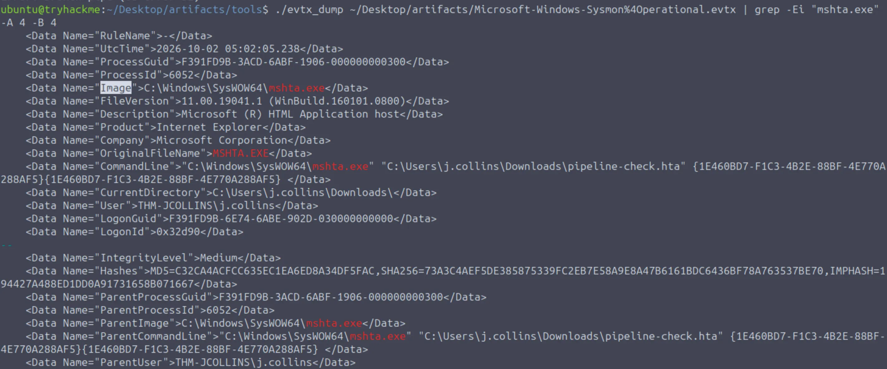
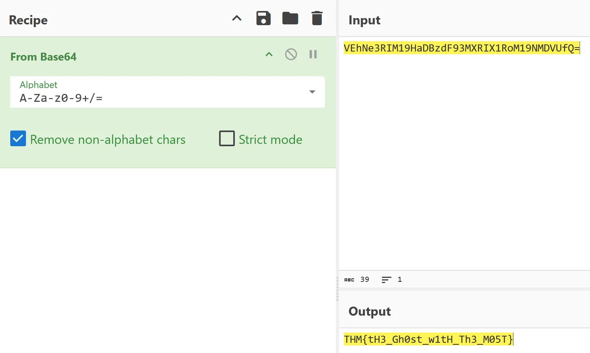

<h1> TryHackMe: Handbook for the Recently Compromised — Write-up</h1>

**Platform:** TryHackMe | **Difficulty:** Easy | **Time:** ~30 min
**Category:** Windows Forensics, Log Analysis (EVTX), DFIR
**Author:** Roki | [GitHub](https://github.com/Rohanth2155)

> **Scenario:** A Windows workstation was flagged for unusual activity. Using the collected Windows event logs, reconstruct the intrusion timeline and determine what the attacker achieved.

---

## 1. Summary

| Item | Finding |
|---|---|
| Initial execution | Malicious attachment executed via a Windows script/proxy-execution binary |
| Ingress tool transfer | `certutil.exe` (LOLBin) downloaded a second-stage script |
| Payload URL | `http://pipeline-cdn.thm:8088/pipeline-sync.ps1` |
| Persistence | Scheduled Task (T1053.005) |
| Final stage | Obfuscated PowerShell (Base64) revealing the flag |

## 2. Evidence & Tools

**Evidence:** `Microsoft-Windows-Sysmon%4Operational.evtx`, `PowerShell-Operational.evtx`

| Tool | Purpose |
|---|---|
| `evtx_dump` | Converts binary `.evtx` logs into readable text |
| `grep` | Filters lines by pattern (`-i` ignore case, `-E` regex, `-A/-B` context lines) |
| `\|` (pipe) | Chains commands to narrow large logs step by step |
| `base64` / CyberChef | Decodes obfuscated strings |

## 3. Methodology

1. Dump logs to text with `evtx_dump`.
2. Pivot on **process creation** (Sysmon Event ID 1) and its `CommandLine` field.
3. Correlate parent/child processes and timestamps.
4. Map behaviours to **MITRE ATT&CK**.
5. Decode final-stage artefacts.

---

## 4. Walkthrough

### Task 1: Obfuscated LOLBin

**Q:** A trusted Windows utility downloaded a second-stage script. The command obscured its name with a wildcard. What is the executable name?

```bash
./evtx_dump ~/Desktop/artifacts/Microsoft-Windows-Sysmon%4Operational.evtx | grep -i "CommandLine" | grep "\*"
```

📸 ``

**Answer:** `certutil.exe`

**Analysis:** Attackers use wildcards in paths to evade simple string-based detections. `certutil.exe` is a known LOLBin ([LOLBAS](https://lolbas-project.github.io/)) abused for file download.

### Task 2: Payload URL

**Q:** What full URL did the utility retrieve the script from?

Same event as Task 1. The URL follows the `-urlcache -f` arguments.

📸 ``

**Answer:** `http://pipeline-cdn.thm:8088/pipeline-sync.ps1`

### Task 3: Initial Execution Technique

**Q:** Which MITRE sub-technique describes the abuse of the scripting host that executed the initial attachment?

```bash
./evtx_dump ~/Desktop/artifacts/Microsoft-Windows-Sysmon%4Operational.evtx | grep -Ei "mshta.exe|wscript.exe|cscript.exe" -A 4 -B 4
```



**Evidence:** Sysmon process creation shows `C:\Windows\SysWOW64\mshta.exe` (OriginalFileName `MSHTA.EXE`) launching `C:\Users\j.collins\Downloads\pipeline-check.hta` as user `THM-JCOLLINS\j.collins` at `2026-10-02 05:02:05 UTC`, medium integrity. A user-downloaded `.hta` opened through the signed Microsoft HTML Application Host is proxy execution of a malicious attachment.

**Answer:** `T1218.005` (System Binary Proxy Execution: Mshta)

### Task 4: Persistence

**Q:** Which MITRE sub-technique describes the persistence mechanism?

```bash
./evtx_dump ~/Desktop/artifacts/Microsoft-Windows-Sysmon%4Operational.evtx | grep -i "schtasks" -A 4 -B 4
```

📸 ``

**Answer:** `T1053.005` (Scheduled Task/Job: Scheduled Task)

### Task 5: Final Flag

```bash
./evtx_dump ~/Desktop/artifacts/PowerShell-Operational.evtx | grep -i "ScriptBlockText" -A 10
echo "VEhNe3RIM19HaDBzdF93MXRIX1RoM19NMDVUfQ==" | base64 -d
```

📸 ``
Decoded in CyberChef (**From Base64**, non-strict). The string was logged as `...MDVUfQ=`; CyberChef tolerates the missing padding, while `base64 -d` needs the full `==` shown above.



**Flag:** `THM{tH3_Gh0st_w1tH_Th3_M05T}`

---

## 5. Attack Timeline

| Stage | Behaviour | ATT&CK |
|---|---|---|
| 1 | Malicious attachment executed | T1218.005 |
| 2 | `certutil.exe` downloads `pipeline-sync.ps1` | T1105 Ingress Tool Transfer |
| 3 | Scheduled task created | T1053.005 |
| 4 | Obfuscated PowerShell executes | T1059.001, T1027 |

## 6. Indicators of Compromise (IOCs)

| Type | Value |
|---|---|
| Domain | `pipeline-cdn.thm` |
| URL | `http://pipeline-cdn.thm:8088/pipeline-sync.ps1` |
| File | `pipeline-check.hta` (initial attachment, `C:\Users\j.collins\Downloads\`) |
| File | `pipeline-sync.ps1` |
| Affected user | `THM-JCOLLINS\j.collins` |
| Binary abused | `certutil.exe` |

## 7. Detection & Mitigation

- Alert on `certutil.exe` with `-urlcache`, `-f`, or wildcards in the command line.
- Alert on `schtasks /create` from non-admin or unusual parent processes.
- Enable PowerShell Script Block Logging (Event ID 4104) and Sysmon process creation (Event ID 1).
- Block or restrict `mshta.exe`, `wscript.exe`, `cscript.exe` via AppLocker/WDAC where not needed.
- Egress filtering on non-standard ports (e.g. 8088).

## 8. Key Takeaways

- LOLBins let attackers blend in with trusted binaries; command-line logging is essential.
- Correlating timestamps and parent/child processes turns isolated events into a story.
- Mapping to MITRE ATT&CK makes findings reusable for detection engineering.

## 9. References

- [MITRE ATT&CK](https://attack.mitre.org/)
- [LOLBAS Project](https://lolbas-project.github.io/)
- [evtx_dump (omerbenamram/evtx)](https://github.com/omerbenamram/evtx)
- [CyberChef](https://gchq.github.io/CyberChef/)
